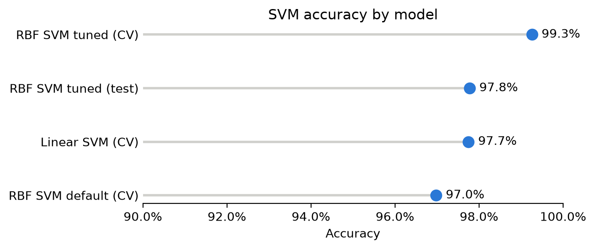
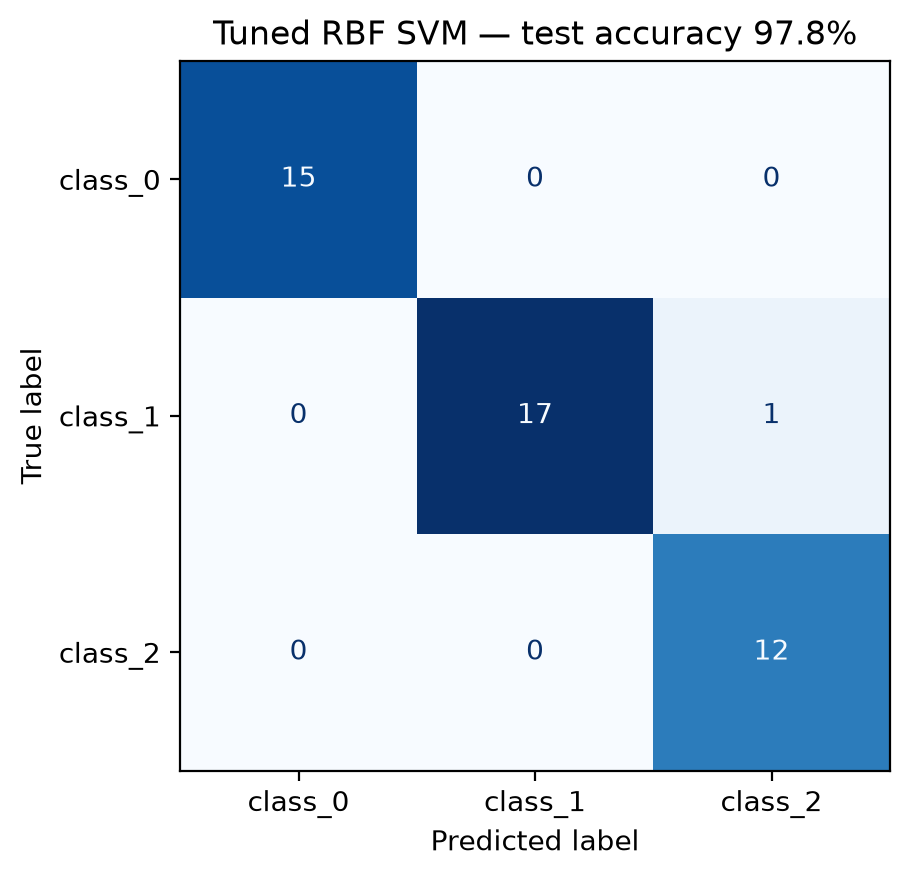
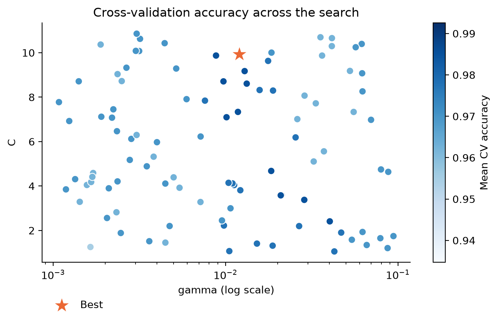

# Wine Classifier

Classifying wines into three cultivars from 13 chemical measurements using Support Vector Machines (SVMs) in scikit-learn.

## Dataset

The [UCI Wine dataset](https://archive.ics.uci.edu/ml/datasets/wine), loaded with `sklearn.datasets.load_wine`:

- 178 wines from three cultivators in the same region of Italy
- 13 numeric features (alcohol, malic acid, flavanoids, colour intensity, proline, …)
- 3 classes: `class_0` (59), `class_1` (71), `class_2` (48)
- No missing values

## Approach

1. Split the data into training (133 wines) and test (45 wines) sets.
2. Standardise the features with `StandardScaler`, since they sit on very different scales (proline runs into the hundreds, hue stays below 2).
3. Compare a **linear SVM** (`LinearSVC`) against an **RBF-kernel SVM** (`SVC`) using 5-fold cross-validation.
4. Tune the RBF SVM's `C` and `gamma` with `RandomizedSearchCV` (100 iterations, `C` uniform between 1 and 11, `gamma` log-uniform between 0.001 and 0.1).
5. Evaluate the best model on the held-out test set.

## Results

| Model | Accuracy |
|---|---|
| Linear SVM (CV) | 97.7% |
| RBF SVM, default (CV) | 97.0% |
| RBF SVM, tuned (CV) | 99.3% |
| **RBF SVM, tuned (test)** | **97.8%** |

Best hyperparameters: `C ≈ 9.93`, `gamma ≈ 0.012`.



The tuned model classified 44 of the 45 test wines correctly. Its one mistake was predicting a `class_1` wine as `class_2`.



Cross-validation accuracy was highest around `gamma ≈ 0.01` and changed less with `C` across the range searched.



**Takeaway:** the linear SVM performs almost as well as the tuned RBF SVM, which suggests the three classes are close to linearly separable once the features are standardised.

## Running it

```bash
python -m venv .venv
source .venv/bin/activate
pip install scikit-learn pandas numpy scipy matplotlib jupyterlab
jupyter lab wine_classifier.ipynb
```

## Files

- `wine_classifier.ipynb`: the full analysis
- `confusion_matrix.png`, `hyperparameter_search.png`, `model_comparison.png`: the result charts
